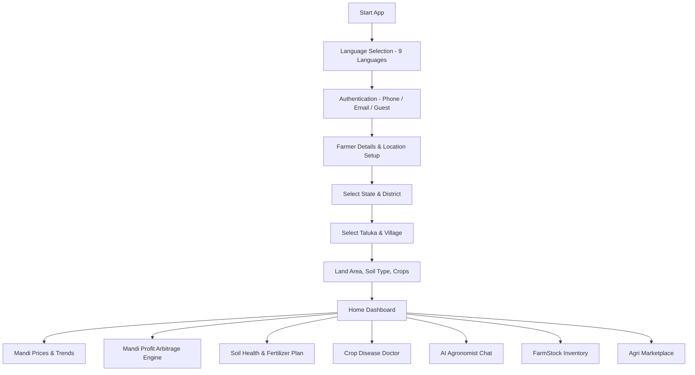

# 🌾 AgriPulse (KisanMitra) Mobile App

[](https://flutter.dev)
[](https://dart.dev)
[](https://supabase.com)
[](#)
[](LICENSE)
[](#-multilingual-support)

> **Empowering Indian farmers with data-driven decision making, real-time APMC mandi market intelligence, spatial profit arbitrage calculations, and AI-powered agronomic assistance.**

---

## 📌 Overview

**AgriPulse** (also known as **KisanMitra**) is a modern, cross-platform mobile application developed using Flutter. It is designed specifically to address the core challenges faced by smallholder and commercial farmers across India:

1. **Information Asymmetry & Distress Selling:** Farmers often sell to local intermediaries at low prices due to a lack of visibility into real-time rates at distant, higher-paying APMC mandis.
2. **Hidden Logistics Costs:** Traveling to a distant mandi is risky without knowing whether the higher market price covers fuel, transport freight, mandi cess, and transit crop loss.
3. **Language & Digital Literacy Barriers:** Complex tech solutions fail if they are not accessible in the farmer's native tongue.
4. **Soil & Crop Health Management:** Inefficient fertilizer application degrades soil health and increases input costs without expert diagnostic guidance.
5. **Produce Inventory Tracking:** Inability to track stored post-harvest batches and calculate their current liquidation value against live market rates.

AgriPulse solves these problems within a unified, intuitive, offline-resilient mobile app built with Google's Material 3 design system.

---

## 🚀 Key Features

### 📊 1. Real-Time APMC Mandi Intelligence
- **Live Commodity Prices:** Real-time tracking of modal, minimum, and maximum prices for cereals, pulses, vegetables, fruits, and commercial crops across APMC mandis in India.
- **Arrival Volumes & Trends:** Daily arrival metrics (in quintals) paired with trend indicators (`UP`, `DOWN`, `STABLE`) and daily price percentage changes.
- **Mandi Search & Filters:** Filter by state, district, crop category (Grains, Pulses, Vegetables, Fruits, Oilseeds, Spices), and sort by price or distance.

### 🚚 2. Inter-Mandi Profit Arbitrage Engine
- **Spatial Logistics Calculator:** Calculates true **Net Realization per Quintal** to determine if transporting produce to a distant APMC mandi is genuinely more profitable than selling locally.
- **Cost Factor Breakdown:**
  - Real road distance (via Haversine & geo-coordinates).
  - Selected transport vehicle profile (Piaggio Ape, Tata Ace, Mahindra Bolero, Eicher 14ft, etc.).
  - Estimated transit loss/shrinkage percentage.
  - Mandi commission and APMC user cess.
- **Actionable Recommendation:** Clear, unambiguous advice (e.g., *"Sell locally — transport wipes out gain"* or *"Travel to Pune APMC — Net Gain: +₹18,400"*).

### 🗣️ 3. Native Multilingual Support (9 Indian Languages)
Built-in instant translation engine supporting:
- 🇬🇧 English
- 🇮🇳 Hindi (हिंदी)
- 🇮🇳 Marathi (मराठी)
- 🇮🇳 Bengali (বাংলা)
- 🇮🇳 Telugu (తెలుగు)
- 🇮🇳 Tamil (தமிழ்)
- 🇮🇳 Gujarati (ગુજરાતી)
- 🇮🇳 Punjabi (ਪੰਜਾਬੀ)
- 🇮🇳 Kannada (ಕನ್ನಡ)

### 📍 4. 4-Tier Geo-Hierarchy Onboarding
- **Granular Geographic Cascades:** `State` ➔ `District` ➔ `Taluka / Tehsil` ➔ `Village`.
- Pre-populated datasets covering Maharashtra and pan-India districts/talukas, with automated fallback to the All-India Villages API.
- **Farmer Profile Personalization:** Land area (acres/hectares), soil type (Black Cotton, Alluvial, Red, Laterite, etc.), irrigation source (Drip, Sprinkler, Canal, Borewell, Rainfed), and primary/secondary crops.

### 🧪 5. Soil Health & Scientific Fertilizer Schedules
- **Soil Health Card:** Digital record of Nitrogen (N), Phosphorus (P), Potassium (K), pH balance, Electrical Conductivity (EC), and Organic Carbon (OC).
- **Localized Crop Suitability:** AI recommendation score (0–100%) indicating best-fit crops based on district soil characteristics and season.
- **Stage-Wise Fertilizer Regimen:** Customized dosage instructions for Basal, Vegetative, Flowering, and Harvest stages.

### 🩺 6. Crop Doctor & Disease Diagnostics
- Catalog of common crop diseases across regional cash crops (Tomato, Onion, Cotton, Wheat, Sugarcane, Soybean, etc.).
- Symptoms breakdown, causative pathogens, biological/organic management, and chemical fungicides/insecticides with safety intervals.

### 🤖 7. AI Agronomist Chatbot
- Conversational conversational assistant equipped with agricultural domain knowledge.
- Helps farmers with real-time pest advisories, sowing calendars, weather forecasts, government subsidy schemes, and market timing tips.

### 📦 8. FarmStock (Inventory & Harvest Manager)
- Track stored farm produce: crop, variety, harvest date, quantity (bags & quintals), storage location, and moisture content.
- Dynamic portfolio valuation: Automatically estimates the total market value of your stored inventory based on current day APMC prices.

### 🛒 9. Agricultural Input Marketplace & Inquiries
- Browse certified seeds, fertilizers, biological insecticides, and micro-irrigation tools.
- Integrated cart, order summary, and order request flow.

### 🔔 10. Weather & Agro-Advisories
- Early warnings for unseasonal rains, frost, heatwaves, and pest swarm notices.
- Push notification support for sudden price surges in subscribed commodities.

---

## 🏗️ Architecture & Technology Stack

```
lib/
├── data/
│   ├── models/
│   │   └── models.dart                  # Core data entities (Commodity, MandiRecord, FarmerProfile, Arbitrage, etc.)
│   └── services/
│       ├── api_service.dart             # Mandi API & external network integration
│       ├── location_service.dart        # Spatial calculations, Haversine distance & arbitrage logic
│       ├── all_states_location_data.dart# Complete hierarchy: States, Districts, Talukas
│       ├── maharashtra_location_data.dart# Enriched Maharashtra village & tehsil database
│       ├── soil_analysis_service.dart   # Soil health, NPK parameters & crop suggestions
│       ├── crop_catalog_service.dart    # Comprehensive crop metadata & agronomy guide
│       ├── payment_service.dart         # Checkout & payment processing
│       ├── mock_data.dart               # Seed & offline fallback data
│       └── supabase_service.dart        # Supabase client, queries & sync helpers
├── providers/
│   ├── agri_provider.dart               # Central state management (markets, crops, stock, profile)
│   └── language_provider.dart           # Multilingual localization & language state
├── ui/
│   ├── screens/
│   │   ├── onboarding/
│   │   │   ├── select_language_screen.dart # Language selection screen
│   │   │   ├── login_screen.dart           # Supabase Auth (Email / Phone / Guest)
│   │   │   └── your_details_screen.dart    # Farmer profile & location setup
│   │   ├── home_screen.dart             # Main dashboard, alerts & quick actions
│   │   ├── markets_screen.dart          # Live APMC rates & commodity trends
│   │   ├── market_profit_arbitrage_screen.dart # Spatial mandi arbitrage calculator
│   │   ├── prices_screen.dart           # Price analytics & historical trends
│   │   ├── profit_calculator_screen.dart# Crop economics & profit estimator
│   │   ├── soil_screen.dart             # Soil health card & fertilizer scheduler
│   │   ├── disease_screen.dart          # Plant pathology & crop doctor
│   │   ├── chat_screen.dart             # AI Agronomist chatbot
│   │   ├── farm_stock_screen.dart       # Harvest storage & inventory tracker
│   │   ├── store_screen.dart            # Agri-store marketplace & checkout
│   │   ├── alerts_screen.dart           # Agro-meteorological warnings
│   │   └── main_navigation.dart         # Bottom navigation hub
│   └── theme/
│       └── app_theme.dart               # Material 3 styling (Forest Green & Earth Sand)
└── main.dart                            # App entry point, Supabase initialization & router
```

### 🛠️ Tech Stack & Dependencies

| Layer | Technology |
|---|---|
| **Framework** | [Flutter](https://flutter.dev) (v3.11+ / Dart 3.x) |
| **State Management** | [`provider`](https://pub.dev/packages/provider) |
| **Backend & Auth** | [`supabase_flutter`](https://pub.dev/packages/supabase_flutter) (PostgreSQL, RLS) |
| **Local Storage** | [`shared_preferences`](https://pub.dev/packages/shared_preferences) |
| **Location & Spatial** | [`geolocator`](https://pub.dev/packages/geolocator) + Custom Haversine Formulas |
| **Networking & HTTP** | [`http`](https://pub.dev/packages/http) |
| **Internationalization** | Custom Multi-Language Engine + [`intl`](https://pub.dev/packages/intl) |
| **Icons & Design** | Material 3 + Cupertino Icons |

---

## ⚙️ Getting Started

### Prerequisites

Ensure you have the following installed on your development machine:
- [Flutter SDK](https://docs.flutter.dev/get-started/install) (`^3.11.0` or higher)
- [Dart SDK](https://dart.dev/get-dart)
- [Android Studio](https://developer.android.com/studio) / Xcode (for iOS) / VS Code with Flutter Extension
- Android / iOS physical device or emulator

### Installation

1. **Clone the repository:**
   ```bash
   git clone https://github.com/YashNawal/AgriPulse-app.git
   cd AgriPulse-app
   ```

2. **Install project dependencies:**
   ```bash
   flutter pub get
   ```

3. **Configure Backend (Supabase):**
   The application connects to Supabase for authentication and profile sync. The initialization keys are configured in `lib/main.dart`:
   ```dart
   await Supabase.initialize(
     url: 'YOUR_SUPABASE_URL',
     anonKey: 'YOUR_SUPABASE_ANON_KEY',
   );
   ```

4. **Run the application:**
   ```bash
   # Run on connected device or emulator
   flutter run

   # Or specify your target platform
   flutter run -d chrome
   flutter run -d android
   ```

---

## 🧪 Running Tests

The project includes unit tests for core domain logic, such as spatial mandi arbitrage calculations and inventory stock management:

```bash
# Run all unit tests
flutter test

# Run specific test suites
flutter test test/market_arbitrage_test.dart
flutter test test/farm_stock_and_location_test.dart
flutter test test/advisory_chat_test.dart
```

---

## 📱 User Flow



---

## 🤝 Contributing

Contributions, bug reports, and feature requests are welcome!
1. Fork the Project
2. Create your Feature Branch (`git checkout -b feature/AmazingFeature`)
3. Commit your Changes (`git commit -m 'Add some AmazingFeature'`)
4. Push to the Branch (`git push origin feature/AmazingFeature`)
5. Open a Pull Request

---

## 📄 License

This project is licensed under the MIT License — see the [LICENSE](LICENSE) file for details.

---

## 👨‍💻 Author & Acknowledgments

- **Developed by:** Yash Nawal & Team
- **Project:** Final Year Capstone Project — AgriPulse (KisanMitra)
- Built with ❤️ for the farming community of India.
